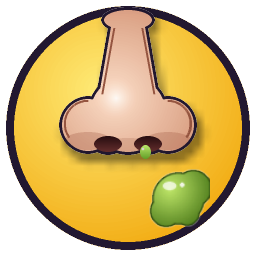

# Pick 'n' Flick（ピック・アンド・フリック）

A carnival shooting-gallery **spelling game** for kids. Pick the nose, flick boogers at letters
riding three conveyor belts, and spell the word shown under the gallery window.

**Version: v0.2.0** · Created by **Shawn Rapaz and Claude Code** · Website: <https://shoukugames.org/> · Email: info@shoukugames.org



---

## Features

- **Three-belt shooting gallery**
  - Top belt: fast, moves left → right
  - Middle belt: medium speed, moves right → left
  - Bottom belt: slowest, moves left → right, reverses when it has travelled halfway, then repeats
- **Spell the word** under the gallery one letter at a time. 3 words per level.
- **10 levels.** Level 1 uses 2-letter words, level 2 uses 3-letter words, and so on up to 11-letter words in level 10. The belts get faster and tissues show up more often each level.
- **Real flicks:** the finger curls back against the thumb, then snaps straight to launch the booger.
- **Booger ammo:** you get 3 flicks, then you must **hold SPACE for 3 seconds** to pick the nose (shown on the right of the screen) and reload.
- **Tissues** show up at random on the belts. Hit one and you lose a finger (a life).
- **3 lives**, shown as fingers to the right of the timer. **One continue** per game.
- **120-second countdown** per level at the top of the screen, with the score above it. Running out of time costs a finger and resets the clock.
- **Difficulty:** Easy (ages 4+), Medium (ages 8+) and Hard (ages 12+), each with its own word list.
- **English / 日本語** toggle in the main menu. In Japanese mode the whole interface is in Japanese and each word shows its meaning (e.g. `CAT – いみ：ねこ`), so it also works as English practice.
- **Top 10 high scores** with name entry (Japanese IME input works too).
- **Parent Progress Report:** games played, play time, accuracy, levels cleared per difficulty, a chart of recent games, most-practiced words and the letters the child struggles with.
- **Ending:** clearing level 10 shows fireworks, "Congratulations" and "Thank you for playing". Press ENTER to return to the main menu.
- **Level Select** unlocks in the main menu once the game has been beaten (all 10 levels).
- **Credits** page with contact information.
- **Background music:** every level has its own upbeat original chiptune song (about a minute long before it loops), with a verse, a chorus with harmony, a second verse and a breakdown that builds back in. Each song uses its own key, tempo, groove (bounce, disco, funk, shuffle, gallop and more) and instruments, and the tempo rises from 112 BPM on level 1 to 158 BPM on level 10. Songs are composed in the background while you play, so level changes never pause. The main menu and the ending have their own tunes too. Turn music on or off with **Music (BGM)** in the main menu, or press **B** at any time.
- **Sound FX** toggle sits separately in the main menu (or press **M**).
- **Graphics:** anti-aliased art rendered at 3x and smoothed down, with gradients, gloss, soft drop shadows, glowing carnival bulbs, velvet curtains, a wood-grain word board and glowing fireworks. The window can be resized or made fullscreen (F11) and scales smoothly.
- Art, music and sound effects are all generated by code, so the game ships no image or audio files.

## Controls

| Key | Action |
|-----|--------|
| ← → | Move the flicking finger |
| ↑ ↓ | Choose which belt to aim at (the selected belt glows) |
| SPACE (tap) | Flick a booger |
| SPACE (hold 3 s, when out of boogers) | Pick the nose to reload 3 boogers |
| ESC / P | Pause |
| M | Sound effects on/off |
| B | Background music on/off |
| F11 | Toggle fullscreen |
| ENTER | Confirm in menus |

## Scoring

| Event | Points |
|-------|--------|
| Correct letter | belt points × level × difficulty multiplier (top belt 50, middle 30, bottom 20) |
| Word complete | 50 × level × multiplier |
| Level clear time bonus | seconds left × 2 × level × multiplier |
| Wrong letter | Easy: no penalty · Medium: −5 × level · Hard: −10 × level |

Difficulty multiplier: Easy ×1, Medium ×1.5, Hard ×2.

## Installing

### Linux (Debian / Ubuntu)
```bash
sudo apt install ./picknflick_v0.2.0_amd64.deb
picknflick            # or launch "Pick 'n' Flick" from your applications menu
```
Uninstall with `sudo apt remove picknflick`.

### Windows
Run `PickNFlick-v0.2.0-windows.exe`. It is a single portable file, so there is nothing to install.
Windows SmartScreen may warn because the file is unsigned. Click **More info → Run anyway**.

### Run from source (any OS)
```bash
python3 -m pip install -r requirements.txt
python3 main.py
```

Save data (settings, scores and progress) is stored in:
- Linux: `~/.local/share/PickNFlick/save.json`
- Windows: `%APPDATA%\PickNFlick\save.json`

## Building

All build output goes into `builds/`, which is ignored by git.

```bash
python3 -m pip install -r requirements-build.txt
./build_linux.sh      # -> builds/picknflick_v<version>_amd64.deb
./build_windows.sh    # -> builds/PickNFlick-v<version>-windows.exe  (cross-built with Wine)
./build.sh            # both
```

- `build_windows.sh` needs `wine`, `curl` and `unzip`. The first time it runs, it sets up a private Windows Python in `~/.wine-picknflick` (override with `WINEPREFIX=...`).
- On Windows itself, run `build_windows.bat` instead.

## Tests
```bash
python3 -m unittest discover -s tests
```

## Project layout
```
main.py              entry point
pnf/app.py           window, main loop, scene switching
pnf/game.py          gameplay (belts, boogers, nose picking, lives, timer, levels)
pnf/belt.py          conveyor belt logic (loop and ping-pong)
pnf/scenes.py        menu, level select, how-to, scores, name entry, credits, parent report, victory
pnf/words.py         word lists per difficulty and length (with Japanese meanings)
pnf/i18n.py          English / Japanese text
pnf/storage.py       save file: settings, top-10 scores, progress
pnf/audio.py         synthesized sound effects
pnf/music.py         procedural background music (one track per level + menu + victory)
pnf/gfx.py           super-sampled procedural art, shadows, glows, particles, fireworks
assets/fonts/        M PLUS Rounded 1c (SIL Open Font License 1.1)
packaging/linux/     .desktop file
tools/make_icons.py  generates assets/icon.png and assets/icon.ico
```

## Reporting bugs
See [BUGREPORT.md](BUGREPORT.md).

## License
The game is licensed under the GNU GPL v3 (see `LICENSE`).
The M PLUS Rounded 1c font is © The M+ FONTS Project Authors and licensed under the SIL Open Font License 1.1 (see `assets/fonts/OFL.txt`).
